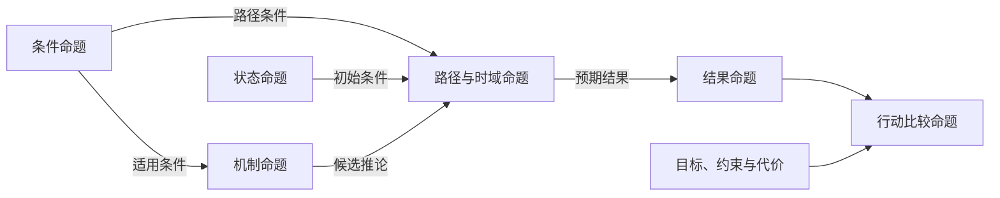

研究与决策中的许多判断，都需要随证据不断更新。但材料越来越多，不自动意味着理解越来越可靠。

本文提出一套可记录的更新方法：**先区分命题及其依赖，再把证据定位到对象、变量与时间尺度，检查它经过哪些条件影响其他判断。** 支持增强、减弱、未变与暂时无法判断，都应有相应理由。

正文依次给出命题依赖图、十二项自查、传导与修订规则、记录模板及抽象条件推演。整套方法仍需独立检验；它用于研究审查。

## 一、先建立命题依赖图

一个总体判断，往往包含多个不能相互替代的命题：

| 命题类型 | 需要明确什么 |
|---|---|
| 结果命题 | 在什么条件和时域内，预期出现什么可观察结果 |
| 机制命题 | 哪些变量经由什么关系产生变化；有哪些竞争解释 |
| 条件命题 | 哪项条件是必要、充分、促进或抑制条件，依据是什么 |
| 状态命题 | 相关变量当前处于什么状态，测量与估计有何不确定性 |
| 路径与时域命题 | 通过什么中间过程、在什么期限内到达结果 |
| 行动比较命题 | 在给定目标、约束与代价下，怎样比较候选行动与暂不行动 |

这些是可选的拆分维度，不要求每次都填齐，也不构成固定层级。一个条件可以影响多个命题，同一结果也可以由多个机制解释，因此用依赖图比强制排成单一路径的树更合适。

这只是依赖关系的示意，箭头不代表关系已经被证明，也不表示观察到结果就确认了上游机制。存在反馈时，应标明不同时间的节点，避免把同一时点的相互支持写成循环证明。

为每个节点分配稳定标识，写明内容、条件、时域与版本；为每条依赖记录类型、依据和未知。**一项证据可以更新多个节点，但每次传播都要交代路径。** 共同来源或同一冲击产生的多个观察，也不能因为挂在不同节点上就重复计为独立验证。

评价标准应当对称。支持与反对材料不必数量相等；不同质量、相关性和独立性的资料，仍应得到不同权重。

## 二、每次证据更新的十二个自查问题

### 搜集：没有进入资料库的是什么

**1. 本轮究竟在检验哪个命题？** 标明命题节点、版本及直接依赖，写明研究对象、目标变量、评价时域与资料截止时间；标明相关快慢过程及判断依据，未知时保留未知。保留至少一个有解释力的竞争假说。

**2. 搜索是否预设了有利答案？** 记录检索范围、检索词、资料来源和停止条件。检查是否仅搜索“为什么会成功”，而没有同样查找会削弱命题的事实。检索词的差异只是检查线索，不是偏误已经成立的证明。

**3. 查找竞争解释的过程是否留下记录？** 保存查过什么、找到什么及目前缺少什么。“未发现反证”需要说明检索范围，不能直接写成“没有反证”。

### 评价：使用的是不是同一套标准

**4. 好坏消息是否按相同标准评价？** 对来源、时效、口径、可核验程度和与命题的关系，分别给出理由。尤其检查：是否把有利的表态当成兑现，却要求不利资料提供更高等级的证据。

**5. 多条消息是不是同一项证据？** 保留原始出处与依赖关系。转载、共同数据源，以及同一因素带来的多个指标变化，不自动构成多次独立验证。

**6. 这项信息指向哪个变量，能否区分竞争解释？** 先说明它是直接观察、代理指标还是来源的主张，再比较暂时状态、持续变化与机制变化的解释。同一输出若与多个候选机制相容，就不能单独确认其中一个机制；需要寻找它们预期不同的观察。

### 更新：判断到底改变了什么

**7. 对同一命题的判断，是否仅因自身立场或利益而改变？** 比较对象、信息、条件与时域应保持一致。偏好和约束可以合理影响行动，但不能代替对事实的判断。目标、可承受代价或约束改变时，行动比较可以改变，但应与同一事实命题的支持程度分开记录。

**8. 新资料究竟更新了什么？** 分开记录资料质量、状态或参数估计、实际变化、机制判断，以及不同期限的预测。未改变判断可以合理，但“长期未变”不能代替对近期约束的回答，“消息短期”也不能成为免于检查结构影响的理由。

**9. 是否事后修改了期限、标准或命题？** 新事实可能使修改合理；需要保留原版本，说明变更依据。不能把期限无限顺延后的命题，当成原预测一直得到验证；也不能事后改换快慢分类来排除同等质量的反向资料。

### 复盘：记录有没有约束记忆与叙事

**10. 复盘依据原始记录，还是对过程的回忆？** 对照当时可获得的资料、预测、期限与后来结果，保留成功、失败和未知。结果是否有利，与原解释是否正确需要分开检查。

**11. 是否把一个系统、层级或时域的结果当成另一个的证明？** 分别记录直接更新与通过依赖传导的更新。结果变化可以提供线索，但不能跳过中间条件来证明上游机制；不同节点上的同源支持也不能重复计分。

**12. AI任务有没有预设“证明原观点”？** 检查是否要求AI只写支持理由，或强行凑出反对材料。核查应比较原命题与竞争解释、使用一致质量标准，并允许“资料不足”。

上述问题用于发现值得复查的位置。勾选若干项、写满一张表，不能自动证明已经消除偏误，也不应转换为没有校准依据的决策评分。

## 三、证据指向什么变量，又处于什么时间尺度

### 先分清：记录更新、状态变化与关系修订

证据首先是观察和记录。**获得新证据，不等于系统刚刚发生了变化。** 一份今天取得的记录，可能揭示早已存在的条件；一次实际冲击，也可能同时成为新的观察。若信息披露本身改变了预期、行为或资源通道，还要把这条反馈单独建模。

| 更新对象 | 需要回答的问题 | 不能直接推出什么 |
|---|---|---|
| 对已有状态或参数的估计 | 以前不知道、测量不准，还是新资料纠正了旧估计？ | 不能把今天获知，当成今天才发生 |
| 系统状态的实际变化 | 哪个变量在何时、什么条件下改变？ | 一个输出变化，不自动识别其原因或持续时间 |
| 变量之间的关系或约束 | 原有机制、传导路径、适用条件是否需要修订？ | 不能只因结果意外，就宣布结构已经改变 |

三者可以同时发生，也可能尚不能区分。先保留竞争解释，避免把每次坏结果都升级为结构失效，或只改局部估计以维持已经失去条件的机制。

### 快慢属于所研究的过程，不属于消息的外观

至少分开记录四种时间：**事情何时发生、资料何时可得、相关变量的变化或恢复时间、命题的评价时域。** 资料发布或测量的频率，都不能单独决定它反映的是快过程还是慢过程。

以下是条件性比较，不是固定的变量分类：

| 记录及其所指对象 | 相对快慢怎样判断 | 怎样影响命题 |
|---|---|---|
| 某次观测量偏离既有范围 | 相对于能力建设可能较快；也要检查观察期和既有波动范围 | 可更新当前状态；单次波动通常不足以单独识别长期能力，却可能提供进一步查证的线索 |
| 多期、口径可比的过程与结果 | 可能涉及能力积累、资源存量或关系稳定性等较慢变化 | 检查是否真有持续变化，还是共同周期、口径调整或同源记录；连续出现不等于独立验证 |
| 突然披露的历史问题 | 消息很快，所揭示的条件可能已持续很久 | 可大幅修订对慢变量或机制的估计，不能因“只是一天的消息”而排除 |
| 短时冲击与后续传播 | 冲击快，但可能经阈值、累积或反馈改变后续约束 | 检查能否被吸收、何时恢复、是否改变未来路径；不能只看冲击持续多久 |

慢变量不自动容易预测，快变量不自动短暂、无关或均值为零。同一过程在不同目标和时域中可以承担不同角色；证据不足以支持时间尺度分离时，就记录“尚未确定”，不强行分成两类。结构变化也不必然缓慢，状态变化也不必然快速。

### 快慢耦合：局部变化有没有改变后续路径

一次输出偏离，可能被既有结构吸收，也可能暴露缓慢积累的问题，或通过反馈改变另一项约束。需要追踪中间环节：**局部变化 → 哪个通道或余量改变 → 能否恢复 → 是否影响目标时域内的可行路径。**

持续性、传播范围、同步变化及恢复时间，可作为待检查的线索；它们本身不是结构转变的充分证明。反过来，若一项经核实的事件已经改变必要条件，也不能一概要求“再观察几个周期”才承认其影响。

因此，证据评估至少保留四个不同维度：**指向哪个对象、涉及什么时间尺度、资料有多可靠、对当前命题有何后果。** 慢变量证据也可能来源不可靠；一项可靠的快变量观察也可能直接关系到近期约束。

### 更新可以不同步，但不能靠改口径维持原结论

同一资料可能改变近期预测，却尚不足以修改长期能力判断；也可能改变长期机制判断，却不足以确定下一期结果。分别记录这些更新。长期判断未变，并不表示短期约束已经解决；长期结构改善，也不推出短期结果必然有利。

需要持续观察的信号，应事先说明预期持续时间、可区分的观察和复核期限；对已经核实的必要条件变化，则直接重审受影响的命题。**不能把有利波动叫“结构改善”，把同等质量的不利波动叫“短期噪声”，也不能用慢变量叙事无限延后原有期限。**

## 四、沿条件传导，并区分机制重审与机制替换

### 传导不能跳过中间环节

一项观察直接支持哪个节点，与它经由哪些关系影响其他节点，是两件事。记录路径时需要问：

- 中间环节是什么？关系是定义、逻辑依赖、统计关联，还是待检验的因果机制？
- 哪些条件已经有依据，哪些只是暂时假设？未验证的条件不能写成已成立。
- 哪个环节可能阻断传导？时滞、阈值、反馈或恢复过程是否会改变影响？
- 若当前通道不成立，是否还有替代路径？没有观察到结果，能否区分通道失效、时滞未过和观测遗漏？

必要条件缺失，可以使一条路径不再成立，却不自动排除其他路径；促进条件出现，也不自动使结果必然发生。资料不足时，保留分支与未知，不把整条传导链当成一项已确认事实。

### 异常可以触发重审，接受替代机制需要另外的依据

下面是值得检查的线索，不是封闭的准入清单：原先声明的必要条件发生变化；可比条件下反复偏离预期；竞争解释提出了可区分的预测；传导路径或约束发生可核查变化；测量口径、遗漏变量或模型适用范围受到质疑。

需要分开三个动作：

1. **启动检查。** 核查记录、测量、初始状态、参数、适用条件与遗漏；一次异常也可以触发检查。
2. **重新比较解释。** 明确哪些观察使某个机制更受支持或更受质疑，哪些还无法区分。不能只调整局部估计以维持原机制，也不能把意外结果直接当成新机制的证明。
3. **接受修订版本。** 写明改变了哪些关系、适用范围与预测，依据是什么，并保存旧版本。资料不足时保留多个候选或暂缓判断。

**原机制的适用条件不再满足，与原机制在其声明范围内被反驳，必须分开。** 同样，原解释受挫不等于任一替代解释已经成立。

## 五、证据的相关性何时需要重估

旧记录是否真实、它现在支持哪个命题，以及相关条件是否仍成立，需要分别检查。证据不统一按时间自动失效，也不默认按照固定速度衰减。

| 变化 | 需要复核什么 |
|---|---|
| 系统状态或环境改变 | 历史观察是否仍能代表当前状态；原关系是否保持适用 |
| 目标、期限或命题改变 | 原证据是否仍回答同一个问题，能否迁移到新时域 |
| 测量口径、来源或共同依赖改变 | 前后记录是否可比，原先的独立性判断是否仍成立 |
| 预定观察没有出现 | 是否确实有足够观测覆盖、等待时长与出现预期，才可把缺席用于更新 |

对每项重要证据，写明继续相关的条件、可能削弱相关性的变化、下一次复核时点，以及什么情况需要提前复核。复核日期是检查安排，不是证据自动变假的日期。

反复出现的信息，只有在新增可区分内容、测量或覆盖时才提供相应增量；同一事实被反复转述，不会因此积累出更多独立支持。关键条件若已核实改变，也不能只因原定复核日期尚未到来而延后更新。

## 六、把依赖与更新保存为记录

### 命题节点卡：保留原始版本

| 字段 | 记录内容 |
|---|---|
| 节点标识及版本 | 命题、对象、目标量、条件、评价时域与原始记录日期 |
| 上下游依赖 | 直接依赖哪些节点，影响哪些节点；边的类型、依据与未知 |
| 变量、关系与尺度 | 直接观察或代理指标；相关快慢过程、分类依据及耦合路径 |
| 竞争解释与可区分观察 | 其他机制预期什么，哪些观察有助于区分；判定口径 |
| 复核与修订条件 | 何时复核，哪些缺席、反例或适用条件变化要求提前检查 |
| 当前支持程度 | 理由、未知与依据；无校准基础时不填伪精确概率 |

### 证据卡：每项重要资料单独保存

| 字段 | 记录内容 |
|---|---|
| 原始记录、类型与出处 | 事实、来源主张、推断、假说或未知；原始来源及共同依赖 |
| 时间与口径 | 发生时间、资料可得时间；必要时另记实际取得时间与测量口径 |
| 直接指向的节点与对象 | 哪项命题、哪个变量或关系；直接观察、代理指标或其他证据 |
| 传导链与阻断点 | 影响其他节点所需的中间关系、成立条件、时滞、反馈、阻断及替代路径 |
| 更新层次与理由 | 修订估计、确认实际变化或重审机制；分别影响什么时域，哪些判断未变及原因 |
| 持续相关与复核 | 继续相关的条件、相关性减弱或提前重审的触发条件、下一次核查时点 |

### 更新记录：追加，不覆盖原判断

| 日期与证据标识 | 受影响节点及版本 | 更新前后判断与理由 | 传导条件及尚未确认处 | 下一次核查 |
|---|---|---|---|---|
| 待填 | 待填 | 增强、削弱、未变或无法判断 | 待填 | 待填 |

另存检索范围、停止条件与有实质影响的排除记录。更新范围应覆盖有依据的依赖关系；尚未确认的传导影响，标作条件性更新。历史记录可以保留为真，同时被标记为不再代表当前状态。

## 七、一个不带领域背景的条件推演

设某个候选机制提出：在条件集合成立、初始状态处于声明范围时，系统经由一条路径，在给定时域内产生某项结果。另有竞争解释，也能说明部分已有记录。下面各行是可分别出现的情形，不是同一个事件的叙述。

| 新记录 | 直接更新 | 进一步更新所需的条件 |
|---|---|---|
| 对初始状态的测量得到纠正 | 原状态估计与依赖它的预测 | 重新代入候选关系；不据此断言机制刚刚改变 |
| 一项路径必要条件被核实不再成立 | 条件节点及该路径的适用性 | 检查替代路径；不自动宣布所有结果都不可达或原机制普遍错误 |
| 在可比条件下反复偏离预期 | 对原预测的支持，并触发机制检查 | 核查测量、状态估计、参数、适用范围及遗漏，再比较机制 |
| 新观察能区分竞争解释 | 相关机制的相对支持程度 | 说明鉴别条件、资料质量与共同依赖；不把一个解释受挫当成另一个已被证明 |

同一记录对不同节点的影响可以不同。每次只传播有依据的更新，保留尚未确定的环节；不把支持程度、时间尺度和行动评价压成一个总分。

## 八、怎样检验这套方法

1. **过程可复核性。** 原始来源、重复资料、被排除的信息和事后移动的标准，是否更容易识别？可对相同任务采用独立评审。
2. **信息判断。** 是否更早识别有效反证，并减少误报、遗漏与无效查证？快慢分类和依赖图是否帮助定位更新，还是成为维护原结论的理由？
3. **前瞻检验。** 对事前冻结且后来可判定的命题，比较预测、更新与错误。若记录概率，需说明含义并采用合适的评分；确信程度上升不等于改进。
4. **行动后果。** 另行检查目标、风险、代价、反馈与可实现性；更完整的研究记录不自动证明更好的行动结果。

本文提出的是工作性组织方法。它是否减少错误、代价多大、适用于哪些任务，需要独立检验；十二项自查用于研究与复盘，不直接代替特定场景的行动程序。

> **这项资料更新哪个节点，经由什么条件影响其他判断，在什么时域仍然相关？原始记录与修订理由在哪里？**

## 九、相关研究与理论对照

### 外部经验研究

以下是此次检索选择的相关研究，不是穷尽性的系统综述。将不同阶段分开，有助于避免把所有问题都叫作同一种偏误。

| 阶段 | 原始研究及发现 | 需要保留的边界 |
|---|---|---|
| 搜集信息 | Hart等（2009）的元分析发现，信息选择总体偏向与既有观点一致的材料，且受任务与动机条件影响。[1](#study-1) | 跨主题研究，不能直接当作股市中的发生比例；选择反向资料也可能服务当前目标。 |
| 评价信息 | Park等（2013）分析韩国股票论坛场景中的502份投资者回应，发现支持既有信念的信息受到优待。[2](#study-2) | 特定平台与研究场景，不证明所有投资者都如此，也不能由此给出长期收益结论。 |
| 持有后的预期 | Cueva与Iturbe-Ormaetxe（2025）的两项实验发现，买入后对账面亏损股票的预期出现乐观偏移。[3](#study-3) | 属于实验研究；真实股票数据不等于真实账户的长期投资绩效。 |
| 回忆与复盘 | Walters与Fernbach（2021）发现投资记忆存在正向偏差；查看历史收益记录的干预降低了过度自信，但未完全消除。[4](#study-4) | 不证明本文整套清单有效，也没有据此保证未来收益改善。 |
| 评价与更新的区别 | Schoar与Sun（2024）的随机实验发现，一致建议获更高评价，但参与者总体仍随所接收的建议更新信念。[5](#study-5) | 工作论文；喜不喜欢一条建议，与是否发生信念更新，需要分别测量。 |

其中Hart等的研究跨越多个主题，其余几项主要来自投资相关场景。将这些发现迁移到其他领域，需要另行检查任务、动机、反馈与可测结果是否可比。这些研究支持进一步检查信息选择、评价、更新与记忆。它们不支持把每一次不接受反对意见都判为确认偏误，也不支持断言持仓一定使判断失真。

### 与本站既有文档的对照

| 已有内容 | 已经包含的要求 | 本文增加的检查对象 |
|---|---|---|
| 《投资研究与交易决策总纲》第5.1、5.3节 | 固定命题、保留竞争解释，识别同源资料与增量信息 | 搜索与筛选本身是否偏向原命题；资料被收录、排除或降权的理由 |
| 同篇第5.4节 | 证据随环境更新，设验证期限和命题失效检验 | 期限是否因坏消息而事后移动；哪些旧证据仍与当前命题有关 |
| 同篇第9节 | 防止观点固化及人机共同确认偏见，冻结事前记录 | 相同质量标准是否用于好坏消息；AI任务是否预设了必须支持的结论 |
| 《企业分析操作总纲》第3节的07、11、12项 | 检查竞争者、关键证据、反证与估值边界 | 企业命题、价格假设与自身持有状态是否在更新时混为一谈 |
| [《任何系统都是宇宙的子系统》](https://sl-knowledge.github.io/knowledge-site/framework/foundations/systems-within-the-universe)第4、5节 | 快慢与目标、时域相关；快过程不自动等于噪声 | 区分消息到达、变量变化与评价期限，显式记录快慢耦合 |
| [《压力测试》](https://sl-knowledge.github.io/knowledge-site/framework/methods/stress-testing)第ST6、ST8、ST11项 | 检查反馈、恢复窗口与因果识别边界 | 追踪短时变化是否影响其他约束及后续可行路径 |
| 《我们如何知道什么值得进入模型》第2、7、11章 | 区分证据类型，检查竞争解释，保留修订轨迹 | 记录未改变判断的理由，防止把每项不利材料都解释为例外 |

这些要求是本文的相关方法背景。这里给出的依赖图、清单及记录格式，是一种待检验的组织方式。

### 参考研究

1. Hart, W., Albarracín, D., Eagly, A. H., Brechan, I., Lindberg, M. J., & Merrill, L. (2009). Feeling validated versus being correct: A meta-analysis of selective exposure to information. *Psychological Bulletin*, 135(4), 555–588. [全文](https://pmc.ncbi.nlm.nih.gov/articles/PMC4797953/)。
2. Park, J., Konana, P., Gu, B., Kumar, A., & Raghunathan, R. (2013). Information valuation and confirmation bias in virtual communities: Evidence from stock message boards. *Information Systems Research*, 24(4), 1050–1067. [出版方](https://doi.org/10.1287/isre.2013.0492)。
3. Cueva, C., & Iturbe-Ormaetxe, I. (2025). Motivated beliefs about stock returns. *Journal of Banking & Finance*, 178, 107510. [出版方](https://doi.org/10.1016/j.jbankfin.2025.107510)。
4. Walters, D. J., & Fernbach, P. M. (2021). Investor memory of past performance is positively biased and predicts overconfidence. *Proceedings of the National Academy of Sciences*, 118(36), e2026680118. [全文](https://doi.org/10.1073/pnas.2026680118)。
5. Schoar, A., & Sun, Y. (2024). Financial advice and investor beliefs: Experimental evidence on active vs. passive strategies. NBER Working Paper 33001，工作论文。[原始页面](https://www.nber.org/papers/w33001)。

### 本站文档链接

- [《任何系统都是宇宙的子系统》v0.1](https://sl-knowledge.github.io/knowledge-site/framework/foundations/systems-within-the-universe)：第4—6节的时间尺度、变量与噪声、背景及结构变化。
- [《压力测试：约束识别、反馈与恢复窗口》v0.2.1](https://sl-knowledge.github.io/knowledge-site/framework/methods/stress-testing)：ST6、ST8、ST11的反馈、恢复窗口与因果识别边界。
- [《投资研究与交易决策总纲》v0.1.1](https://sl-knowledge.github.io/knowledge-site/framework/methods/investment-research-charter)：第5节的关键证据、独立性和更新；第9节的偏见检查与事前冻结。
- [《企业分析操作总纲》v0.1.1](https://sl-knowledge.github.io/knowledge-site/framework/methods/company-analysis-protocol)：竞争者与反证、关键Evidence和结论边界。
- [《我们如何知道什么值得进入模型》v0.1.2](https://sl-knowledge.github.io/knowledge-site/framework/book/what-belongs-in-a-model)：证据类型、竞争解释、前瞻检验与修订。
- [《投资的三个系统》v0.2.1](https://sl-knowledge.github.io/knowledge-site/framework/book/investment-three-systems)：公司、市场与投资者自身约束的区别。

---

## 研究与版本说明

本文不直接生成操作指令；涉及投资的使用不构成投资或交易建议。

---

© 2026 SL. All rights reserved.
