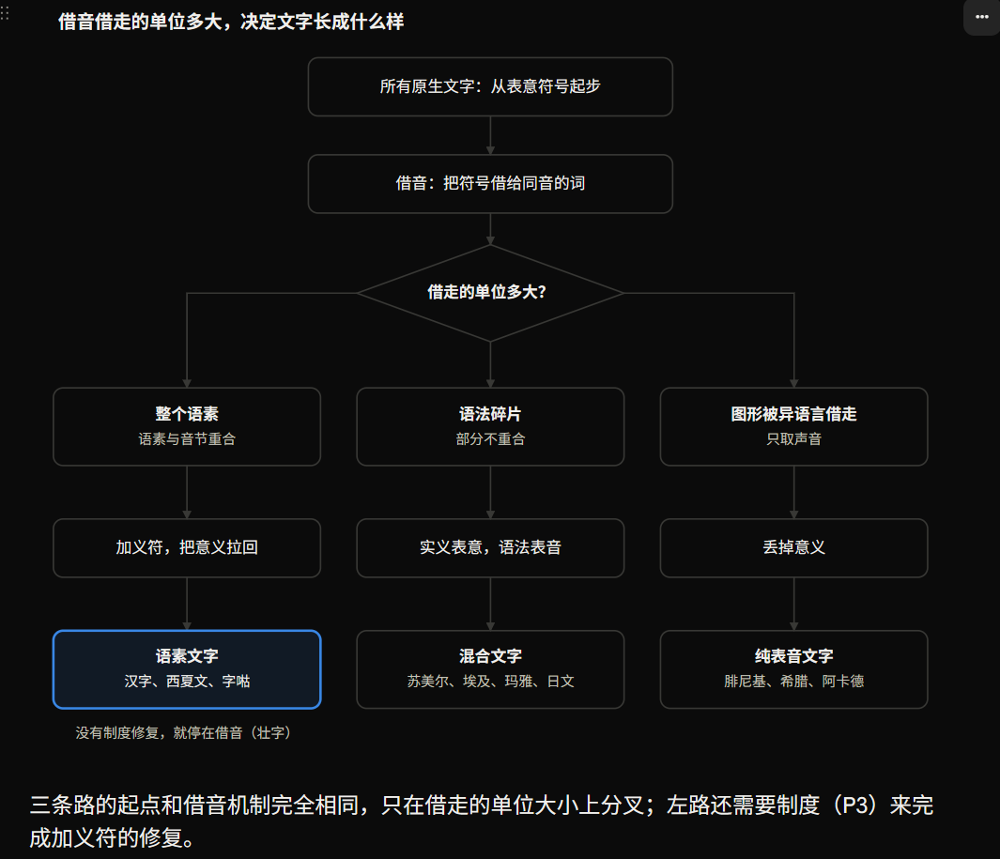

> **理论草稿 v0.1** · 本文包含待检验的假说与推论；证据局限、反例和待核对引用均保留在正文中。

## 摘要

**核心主张：世界上各种文字系统，是同一个生成器在不同参数下长出来的表现型。** 生成器是：书写符号会被拉向它最常记录的那个语音单位；这个单位是什么，取决于语言把意义放在声音流的什么位置。符号记录的是带意义的整块，就和意义绑在一起；记录的是比意义单位小的声音片段，就变成无意义的表音符号。

**汉字为什么绑定在意义上：** 汉语的意义单位大致等于一个音节，又几乎没有黏着在词上的语法成分；文字由说这种语言的人自己从表意符号发明；三千多年里没有被外部事件切断。起点只是近似匹配，有偶然性；但文字一旦绑住意义，就把写不出的小词缀挤出语言，让匹配变得更严，形成正反馈。

**两个容易搞错的地方：**

- 象形不是原因。所有独立发明的文字都从表意起步；埃及文三千年保持象形，却大量表音；汉字隐变后不再像图，却依然表意。象形既不必要，也不充分。
- "单音节"也不够。苏美尔语、玛雅语的词根也多是单音节，但语法靠黏着词缀，文字就长出了表音层。真正的参数是：意义单位是不是一个个独立的、音节大小的整块。

**证据的结构：** 独立发明、又是孤立语的案例只有中国一个。但借汉字造字的周边民族提供了一组自然实验：同样从汉字出发，语言是孤立型的，造出的仍是语素文字；语言是黏着型的，都长出了表音文字（第 4 节）。这把样本从一个扩大到十几个。这批材料 Handel（2019）已有系统整理，本文的新意在于用一个参数统一解释（第 8、9 节）。

**本文真正要展示的是方法：** 不是再给文字系统列一张分类表，而是找一个生成器加几个参数，让已有的分类、例外和历史走向都作为表现型被重新推出来，再用只变一个参数的自然实验去检验。第 8 节用 Handel 的借用分类做了这个演示。文字起源只是这种做法的一个应用。

本文是[《概念打包与字的约束》](./concept-packaging-and-characters.md)的姊妹篇，补上那篇文档缺少的一环：绑定是怎么开始的。

## 1. 生成器：一条规则，三个参数

**规则：一个书写符号，最终绑定在它最常被用来记录的那个单位上。** 记录带意义的整块（语素），符号就绑定意义；记录比语素小的声音片段（辅音、音节碎片、词尾），符号就变成无意义的表音符号。

所有独立发明的文字起步都一样：先有表意符号，记东西、记名字、记数；再用借音，把一个符号借给同音的词。借音是表音的入口。分叉只发生在一件事上：借音时借的单位有多大。

**参数 P1：语素边界和音节边界是否重合。** 这是最关键的参数，比"单音节"或"孤立语"更准确。

- **重合**（汉语、西夏语、越南语、壮语）：每个语素恰好是完整的音节，形式不在内部变化。借音只能整音节地借，借来的仍是一个语素，于是可以再加义符把意义拉回。
- **不重合**：语法成分比音节小，或者嵌在词根中间。埃及语的意义在辅音词根里，元音随语法变；日语"書く kak-u／書かない kak-anai"的词根和词尾在音节中间切开。要写这些成分，就必须有记录声音碎片的符号。

西夏语说明区分的是"重合"，不是"孤立"：西夏语动词形态很复杂，但音节是 CV 结构，各个词缀都是完整音节，单独占一个字，所以仍然用一套近六千字的语素文字书写。

**参数 P2：文字从哪里来。** 是本族人从表意符号自己发明，还是从别的语言借来；借来时它是表意的还是已经表音的。借用时有一条子规则：**借用者只保留对自己语言有用的绑定**。闪米特人借埃及图形只要声音；日本人借汉字，在意义层只要意义（训读：山读 yama）。

**参数 P3：连续性与制度深度。** 是否在同一语言社群里长期连续使用；有没有标准化和教育体系来做"加义符"这类修复；会不会被征服、宗教更替切断。

三个参数组合出三种稳态：

1. **语素文字**：P1 重合，文字从表意起步，并且有制度做修复。
2. **表意表音混合文字**：P1 部分不重合。实义词根仍用表意符号，语法和连接成分用表音符号。
3. **纯表音文字**：被一种不重合的语言借走，或者借来时已经是表音的。

三条路的起点和借音机制完全相同，只在借走的单位大小上分叉；左路还需要制度（P3）来完成加义符的修复。

## 2. 参数表：十四个文字系统

**在已知案例里，三个参数的取值都能推出文字最后的形态。** P1 写"重合"指语素边界和音节边界基本一致；"不重合"指语法成分比音节小、嵌在词根里，或词根和词尾在音节中间切开。

| 文字系统 | 语言 | P1 语素与音节 | P2 来源 | P3 连续性 | 结果 |
| --- | --- | --- | --- | --- | --- |
| 汉字（商代至今） | 汉语 | 重合（上古仍有少量小词缀，后消失） | 原生，表意起步 | 三千多年未中断 | 语素文字；借音字被形声字取代 |
| 苏美尔楔形文字 | 苏美尔语（黏着型） | 部分不重合 | 原生，表意起步 | 语言消亡后作为学术语言保留 | 混合：词根表意，语法标记用音节符号 |
| 埃及圣书字 | 古埃及语（辅音词根） | 不重合 | 原生，表意起步 | 约三千五百年，因希腊化和基督教化终止 | 混合：表意字和限定符加 26 个单辅音符号 |
| 玛雅文字 | 玛雅语（有屈折词缀） | 部分不重合 | 原生，表意起步 | 被西班牙征服切断 | 混合：语法成分用音节符号 |
| 阿卡德楔形文字 | 阿卡德语（闪米特语，词根加元音模式） | 不重合 | 借自苏美尔文字（表意为主） | 长期 | 以音节符号为主，保留少量苏美尔表意字 |
| 原始西奈文字 → 腓尼基字母 | 西北闪米特语 | 不重合 | 借埃及图形，只取首音 | 长期 | 纯辅音字母 |
| 希腊字母 | 希腊语（元音承担屈折） | 不重合 | 借腓尼基字母（已表音） | 长期 | 加入元音字母的全音素字母 |
| 日语文字 | 日语（黏着型） | 不重合（词根和词尾在音节中间切开） | 借汉字 | 长期 | 分工：汉字表意义（训读），假名记词尾和外来词 |
| 朝鲜文字 | 朝鲜语（黏着型） | 不重合 | 借汉字，后自创 | 长期 | 先用汉字记音（吏读、乡札），1443 年创制训民正音 |
| 契丹大字 → 契丹小字 | 契丹语（准蒙古语，多音节黏着） | 不重合 | 仿汉字造（920），数年后另造小字 | 不到三百年，1191 年被禁 | 小字以拼合的表音元素为主 |
| 西夏文 | 西夏语（形态复杂，但词缀是整音节） | 重合 | 仿汉字造（1036） | 西夏亡后渐废 | 语素文字，约 5,863 字 |
| 字喖（越南） | 越南语（孤立型） | 重合 | 借汉字加自造 | 与汉文并用，缺少标准化；20 世纪被拉丁字母取代 | 语素文字；自造字以形声字最常见 |
| 壮族方块字 | 壮语（孤立型） | 重合 | 借汉字加自造 | 民间非正式使用，从未标准化 | 一字一语素，但多数是借音字，形声字极少 |
| 彝文 | 彝语（单音节语素） | 重合 | 本族传统文字 | 未标准化，异体极多；1980 年规范为音节文字 | 传统为表意表音混合；规范后为 756 个音节符号 |

表里没有一个 P1 "不重合"的语言，最后得到纯语素文字；也没有一个 P1 "重合"的语言，在自己发展的过程中长出字母。越南语改用字母、彝文改为音节文字，都是外部的政策决定，属于 P3。

## 3. 原生文字：同一个起点，不同的分叉

**四套公认独立发明的文字，起点完全相同，分叉只在借音单位的大小。** 苏美尔、埃及、商代中国、玛雅都从记物、记名、记数的表意符号开始，都用借音把符号借给同音词。苏美尔语把"嘴"（ka）的符号借来记音节 ka；埃及语把"嘴"（r）的符号借来记辅音 r；玛雅语把"鱼鳍"的符号借来记音节 ka；商代把"来"（麦）借来记来去的"来"。四家的机制一样，借走的单位不一样。

**苏美尔与玛雅：表音层集中在语法上。** 两种语言都把语法成分粘在词根前后。文献对两家的描述几乎一样：音节符号用来写没有专门表意字的语法成分和外来人名，实义词根仍用表意字。这正是《概念打包》一文说的分工：**表示概念用有意义的符号，连接概念用无意义的符号。** 相隔两千多年、互不接触的两套文字，独立走到了同一个分工。

**埃及：字母早就藏在系统里。** 古埃及语的意义在辅音词根里，元音随语法变化而且不写。借音因此以辅音为单位，约公元前 2600 年已经有一套完整的 26 个单辅音符号，另有约 100 个双辅音、约 50 个三辅音符号。但埃及人没有丢掉表意字，还发展出不发音的限定符，用来标明一个词属于哪一类意义。限定符的作用和汉字的义符一样：都是在表音通道旁边把意义拉回来。所以埃及文也有形—义绑定，只是一直有一条辅音通道和它并存。

**商代汉字：借走的是整个语素。** 汉语借音只能整音节地借，而一个音节就是一个语素，所以借音字仍是语素大小的单位，没有产生记录声音碎片的符号。甲骨文里借音用法很多，形声字只占少数（常见统计约三成以下）；到《说文解字》，形声字占到八成以上。这千余年的走向就是生成器在汉语参数下的运行：借音打开表音通道，加义符又把它关回意义。

**其余三家都是被外部事件终止的。** 玛雅文字一直用到西班牙征服，文献被大量焏毁；埃及圣书字随希腊化和基督教化消失，已知最晚的圣书字铭文在公元 394 年；楔形文字在阿拉米字母和希腊化的压力下逐渐停用。所以"只有汉字活下来"一半由 P1 解释，一半由 P3 解释，不能全部归到字的内部结构上。

**未释读的文字**（印度河文字、原始埃兰文字等）参数未知，暂时不能用来检验。

## 4. 派生文字：一组自然实验

**同一套文字借给不同类型的语言，结果按 P1 分化。** 这是本文最强的证据（这批材料 Handel 2019 已系统整理，见第 9 节）：起点相同（都是汉字），变的只是语言，结果就跟着变。

**借汉字，语言与音节重合：造出的仍是语素文字。**

- 西夏文（1036 年）：约 5,863 字，没有一个是象形的，却仍是语素文字。这再次说明象形不是原因，匹配才是。
- 字喖：越南语每个单音节词对应一个字，自造字中最常见的是形声字。借用者重新走了一遍汉字自己走过的路：用声符借音，用义符拉回意义。
- 壮族方块字：同样一字一语素，但在一项 3,231 字的调查里，借音字约占 71%，形声字只有 1.2%。这是一个重要的对照：壮字只在民间使用，从未标准化，也没有教育体系。**P1 决定记录单位的大小；P3 决定意义能不能被拉回来。**

**借汉字，语言与音节不重合：都长出了表音文字。**

- 日语：先用汉字记音（万叶假名），再简化出平假名和片假名，用来记词尾和外来词。意义层则采用训读：保留"山"的意义，丢掉汉语读音，读成 yama。这说明汉字最核心的绑定是形和义，声音可以整个换掉。
- 朝鲜语：先用汉字记音（吏读、乡札），1443 年另创训民正音。
- 契丹语：920 年仿汉字造大字，只过了四五年就另造小字。小字以拼合成方块的表音元素为主，可以记录任何词，词缀用音节符号写。史料记录它受回鹘文字影响，没有给出语言学上的原因。本文的推断是：多音节、黏着型的契丹语装不进一字一音节的大字。四五年就失败，是这条规则最快的一次显现。

**借埃及图形：字母的诞生。** 公元前 19 至 16 世纪，西奈矿区说闪米特语的工人借用埃及图形，用自己语言里该图形名称的首音定音值："房子"的图形因闪米特语 baytu 读 b，"牛头"因 ʾalp 读 ʾ。闪米特语也是辅音词根型，只记辅音恰好够用，于是得到纯辅音字母，就是腓尼基字母的祖先。希腊人再借腓尼基字母时，希腊语的元音承担屈折变化，不写就读不懂，于是加入了元音字母。每一步都是文字长到语言需要的单位。

**借楔形文字：同一个方向。** 阿卡德语是闪米特语，词根和元音模式交错，借来的苏美尔文字主要被当作音节符号用，只保留少量苏美尔表意字。

**彝文：重合型语言还有第二个可行稳态。** 彝语是 CV 音节，连声调共约 1,164 个音节。1980 年规范彝文时，用 756 个基本符号按音节书写。对重合型语言来说，音节文字和语素文字只差一步：同音语素在书面上分不分开。走哪一步由 P3 决定，彝文的选择是政策规范的结果，不是自然演化。

## 5. 汉字：偶然的起点，必然的放大

**汉字的起点有偶然性，放大过程没有。** 偶然的是：这一地区的语言恰好是音节与语素大致重合的类型，说这种语言的人又恰好自己发明了文字。越南语、泰语、苗瑶语都属于同一类型，却没有独立发明文字。一旦两个条件碰在一起，后面的走向就由反馈决定。

### 5.1 起点只是近似匹配

按 Baxter 与 Sagart 的构拟，上古汉语并不严格是一音一义：有前置音节、复辅音，还有前缀 s-、后缀 -s 等比音节小的词缀。也就是说，P1 在起点只是"大致重合"。如果这些小词缀更多、更能产，汉字也可能像埃及文那样，在系统内长出一层记录声音碎片的符号。

### 5.2 反馈把近似变成严格

下面这条反馈链是假说。Hannas 曾以更强的形式提出"文字塑造了汉语的单音节语素结构"，Handel 认为证据不足（见第 9 节）。本文的版本更弱：文字只是加速和锁定了一个已在进行的过程。

1. 字以音节为单位，比音节小的词缀写不出来。
2. 写不出来就看不见，派生关系被记成"同一个字的不同读音"或两个无关的字，词缀失去能产性。
3. 词缀磨损消失，部分变成声调；语言更接近一音一义。
4. 匹配更严之后，字更适合记录语言，借音字又被加上义符。从甲骨文到《说文》，形声字的比例从少数变成多数。
5. 字按意义而不按读音流通，口语不通的方言可以共用一套书面语。秦"书同文"把这一点变成制度，P3 由此加深。
6. 制度越深，改写文字的代价越高，绑定越牢。

这是一个生成性锁定：一个早期的近似条件被系统固化，最后看上去像天生如此。《概念打包》一文第 3 节写了锁定之后的过程；本节补上锁定之前的条件。

### 5.3 甲骨文之前：考古证据说了什么

当前材料支持"甲骨文不是起点"。《人民日报海外版》2025 年 12 月 15 日的综述归纳了以下发现：

| 遗址 | 年代 | 发现 |
| --- | --- | --- |
| 山西襄汾陶寺 | 龙山时代，约 4,100 年前 | 陶扁壶上的朱书文字，释为"文邑"或"文尧"；字形已脱离单纯摹形，书写方法与商代朱书一致 |
| 郑州商城 | 早商 | 陶缸上的朱书，可辨一字为"天" |
| 郑州小双桥 | 早商 | 祭祀器上的朱书，分为数字、象形或族徽、祭祀用语三类 |
| 郑州二里岗 | 早商 | 1953 年出土的牛肋骨刻辞，3 行 11 字，是已知最早的刻辞 |
| 安阳殷墟 | 晚商 | 玉器上的朱墨书写；部分甲骨先书后刻 |

综述的结论是：至迟在商代前期，汉字已经是成熟的系统；主流书写载体很可能是竹木简牍，只是没有保存下来。更早的新石器时代刻画符号（如贾湖、大汶口等地所出）是不是文字，学界仍有争议。

**对本文的含义：**

- 已知最早的汉字书写（陶寺）已经是一字记一词。
- 借音与义符之间的平衡大概在甲骨文之前就开始形成，大部分证据在腐烂的简牍上。
- **一个可以被新发现检验的预测：** 甲骨文之前的汉字材料，只会出现表意符号和整音节借音，不会出现只记辅音或只记音节碎片的符号。如果将来发现这样一层符号，说明上古汉语的小词缀曾经被写出来过，5.2 节的顺序就要改写。

## 6. 推出的规律与可检验的预测

**从第 2–5 节的案例里，可以归纳出五条规律，推出五条预测。**

**规律：**

1. **象形既不必要，也不充分。** 埃及文保持象形却大量表音；西夏文没有一个象形字，却是语素文字。
2. **表音层集中在连接层。** 苏美尔、玛雅的音节符号主要写语法成分；日语假名写词尾；粤语口旁字集中在连接词。表示概念的部分留在表意层。
3. **借用者只保留对自己语言有用的绑定。** 闪米特人从埃及图形里只取声音；日本人的训读从汉字里只取意义。
4. **把意义拉回来需要制度。** 字喖有文人传统，自造字以形声为主；壮字只在民间，形声字只有 1.2%。
5. **已知案例里没有一个语素与音节重合的语言，在自然演化中长出字母。** 字母只在不重合的语言中产生，或由政策引入。

**可检验的预测：**

1. 在任何混合文字的语料中，表音符号在语法和连接成分里的比例，显著高于在实义词根里的比例。可以在苏美尔文、埃及文、玛雅文、日文、粤语书面语中分别统计。
2. 甲骨文之前的汉字材料只会出现表意符号和整音节借音，不会出现只记辅音或音节碎片的符号。
3. 字喖如果有分期语料，形声字比例应随时间上升，重复汉字从甲骨文到《说文》的走向。
4. 在借汉字的语言里，语素和音节越不重合，就越早越多地出现表音层。
5. 如果一种重合型语言自己创制文字并且有制度支撑，结果应是语素文字或大型音节文字，不会是音素字母。

## 7. 边界、反例与未解问题

**这个生成器目前是由对照支持的条件推导，还不是经过统计检验的规律。** 主要弱点有五个：

- **独立样本少。** 公认独立发明的文字只有四套，其中语素与音节重合的只有汉语一家。
- **派生案例有混杂。** 西夏、越南、壮族采用语素文字，也可能只是模仿汉字的威望。反过来的证据是：契丹和日本同样模仿汉字，却走向了表音，可见威望不足以决定结果。但契丹还有回鹘文字的影响，P1 的作用尚未被完全分离出来。
- **语言类型大多是构拟。** 上古汉语的词缀、苏美尔语和契丹语的形态，都有不确定性。契丹造小字的原因，史料只说受回鹘文字影响；"大字装不下黏着语"是本文的推断。
- **统计数字口径不一。** 甲骨文和《说文》里形声字的比例，因计数方法不同而有差异，本文只用"少数→八成以上"这个方向，待核对原始统计。
- **P3 不能从 P1 推出。** 征服、宗教更替、殖民政策是外部变量。越南改用字母、彝文规范为音节文字、埃及和玛雅文字终止，都由它决定。

**未解问题：** 为什么越南语、泰语、苗瑶语等同类型语言没有独立发明文字？这大概与文字发明本身的条件有关，如国家规模、祭祀和记录的需要，而不是与语言类型有关；本文的生成器不解释文字为什么出现，只解释出现以后长成什么样。

## 8. 生成器能否推出已有分类：与 Handel 的逐条对照

**Handel 的借用分类可以由本文的生成器重新推出来，而且生成器还能预测每一类在哪种语言里多、在哪种语言里少。** 这是"分类"和"生成"的区别：分类说明有哪几种，生成器说明为什么是这几种、各在什么参数下出现。

### 8.1 Handel 的分类是一张二维表

Handel 沿用 Boltz 的记法，把一个字写成 G(P, S)：字形 G 同时带着读音 P 和意义 S。这就是《概念打包》一文 3.6 节的三元组 (s, g, m)，前人已经有了。书评可以确认的类别有四个（书中还有其他类别，待读原书补全）：

- **DAL**：直接借用的表意字。连字带词一起借进来，就是汉字词。
- **SAL**：按意义借用的表意字。取字的意义，读本族词，如日语训读"山 yama"。
- **PAP**：按读音借用的表音字。取字的读音，只记声音，如万叶假名。
- **SAP**：按意义借用的表音字。先用训读换成本族词，再拿这个本族词的声音去记别的音。

这些名字由两个维度组成：**借的时候保留哪一种绑定**（读音 P 还是意义 S），和**借来以后记录多大的单位**（整个语素，即表意字；还是声音片段，即表音字）。

### 8.2 两个维度各由什么决定

- **记录多大的单位，由 P1 决定。** 本族语素与音节重合，按读音借来的字仍记一个完整语素，得到表意字；不重合，就只能记声音片段，得到表音字。
- **保留哪种绑定，由"借用者只留有用的绑定"和本族词的长度决定。** 一个本族词如果是单音节，通常能找到读音相近的汉字，按读音借就够了。如果是多音节（yama），没有一个汉字的读音能覆盖它；要用一个字写一个词，只能按意义借。

### 8.3 逐条对照

| Handel 类别 | 在生成器中的位置 | 生成器的预测 | 已知事实 | 状态 |
| --- | --- | --- | --- | --- |
| DAL 直接借用表意字 | 连语素一起借入，读音换成本地音 | 与 P1 无关，多少取决于接触深度 | 日、朝、越都有大量汉字词 | 相符 |
| SAL 按意义借用的表意字 | 留意义，丢读音；一字记一个本族语素 | 本族语素多音节的语言里多，单音节语言里少 | 日语大量训读；Handel 指出孤立的越南语很少用 | 相符 |
| PAP 按读音借用的表音字 | 留读音，丢意义；记声音片段 | P1 不重合的语言里多，且集中在词尾、虚词 | 万叶假名、吏读和乡札、契丹小字的词缀 | 相符；"集中在连接层"待统计 |
| SAP 按意义借用的表音字 | 先按意义换成本族词，再取其声音 | 只在 SAL 发达的语言里出现；越南、壮族应几乎没有 | 日语有训假名 | 日语相符；越、壮部分待查 |
| 按读音借用、却记整个本族语素 | 留读音，丢意义；单位是语素 | P1 重合的语言里应是主导方式 | 壮字约 71% 是借音字；字喖大量用同音汉字记本族词 | 生成器推出的一格；是否已在 Handel 的分类中，待核 |
| 新造字（形声等） | 把意义拉回字形的修复 | 需要制度（P3） | 字喖自造字以形声为主；壮字形声只有 1.2% | 相符 |
| 分化出独立表音文字 | PAP 稳定成一层，字形简化 | P1 不重合，并且长期使用 | 假名；契丹小字；朝鲜语改为另创谚文 | 相符 |

**结论：** Handel 分类表里的每一格，都是同一个生成器在不同参数下的表现型。他的经验发现"越南语很少用 SAL"，在这里变成了推论。生成器还给出了两个可以检验的新结论：越南、壮族几乎没有 SAP；所有语言的 PAP 都集中在连接层。

**局限：** 本节依据的是书评对 Handel 的转述。他的完整类别和各语言的计数，要读原书后核对。如果原书已经把各类频率和语言类型对应起来，本节的贡献就只剩下"用一个参数统一解释"。

## 9. 前人工作说到了哪一步

**本文的核心结论"汉字因语言结构而没有变成字母"，前人已经说过。** 本文新增的是：把多个并列原因压成一个参数，用一个生成器重新推出已有分类，并给出分类做不到的预测。

| 前人 | 说到了哪一步 | 没有说到的 | 对本文的影响 |
| --- | --- | --- | --- |
| Boltz（1994；及其讲座"Why no A-B-C?"） | 把字记作 G(P, S)；埃及文和汉字起点相同、后来分叉；汉字始终保留意义，所以不可能变成字母；原因列为语言结构、历史接触、文化倾向、文字记录语言的方式 | 没有归结为一个参数；没有用派生文字检验 | 本文的出发点就是他的；(s, g, m) 三元组与他的 G(P, S) 是同一个对象 |
| Handel（2019，《Sinography》） | 借用汉字"受接受方语言的类型特征驱动和限制"；给出 DAL、SAL、PAP、SAP 等类别；黏着语两种借用都用，孤立的越南语很少按意义借用；覆盖朝、越、日、壮、契丹、女真，并以苏美尔、阿卡德对照 | 按书评转述，用的是"孤立 / 黏着"分法，没有"边界重合"参数；是否推出各类频率，待读原书 | 第 4 节的材料和大方向他已经有了；本文贡献收缩为第 8 节的"由参数推出分类" |
| Hannas（1997、2003） | 认为文字反过来塑造了汉语的单音节语素结构（据 Handel 书评转述） | Handel 认为这是强假说，缺少严格证据，不接受 | 本文 5.2 节的反馈是这个假说的一个版本，必须标为假说，并给出机制和检验 |
| Tranter（2013，Written Language and Literacy） | 对十几种表词文字做功能性比较，包括苏美尔、埃及、玛雅、西夏、契丹、女真、字喖、壮字、彝文；指出表音补充可以标屈折（阿卡德格尾、日语送假名）；认为统计比较受阻于语言的形态类型 | 没有把"表音集中在语法成分"提升为跨系统规律 | 本文规律 2 是对他这类观察的推广；他的分析框架可以直接用作预测 1 的编码方案；他说的"形态类型阻碍统计"，在本文里正好是要测的参数 P1 |
| 关于文字发明的计算模型（Written Language and Literacy） | 模拟显示：语素多为单音节、或元音交替丰富的语言，更容易从零发明文字 | 讨论的是文字能不能产生，不是产生后长成什么样 | 与本文互补；可用来回答第 7 节的未解问题 |
| Gelb（1952） | 文字从表意到音节再到字母单向演进 | 该观点已被普遍批评 | 本文反对单向演进，这一点不新 |

**由此对本文做的修正：**

1. "汉字为什么没有变成字母"本身不是新结论，归功于 Boltz。
2. 第 4 节的派生文字材料和"类型影响借用"的方向，Handel 已经做过；本文的贡献是用一个参数统一解释，并推出各类频率。
3. 5.2 节的反馈是有争议的假说（Hannas），不是已证实的结论。可以检验的形式是：同样失去词缀的越南语、泰语，是否比汉语保留了更多派生痕迹。
4. 规律 2"表音层集中在连接层"是对各家观察的推广，在统计之前只是假说。

**修正之后仍然成立的新东西：** 边界重合参数（西夏文是区分它与"孤立语"的关键案例）；由生成器推出 Handel 的分类和各类频率；跨原生和派生文字的连接层分工规律；甲骨文之前不会出现音节碎片符号的预测；以及从文字起源一直推到说话代价和学习的整条链。

## 参考来源

- [《人民日报海外版》（2025-12-15）：遥望甲骨文之前](https://paper.people.com.cn/rmrbhwb/pc/content/202512/15/content_30120543.html)
- [Christian Lehmann：Hieroglyphic writing（埃及文字结构）](https://www.christianlehmann.eu/ling/sprachen/languages_antiquity/egypt/hieroglyphs.html)
- [Proto-Sinaitic script（Wikipedia）](https://en.wikipedia.org/wiki/Proto-Sinaitic_script)
- [Maya script（Wikipedia）](https://en.wikipedia.org/wiki/Maya_script)
- [Overview of Sumerian Language and Culture（PSD）](https://psd.alephnull.net/sumerian.html)
- [Tangut script（Wikipedia）](https://en.wikipedia.org/wiki/Tangut_script)；[Tangut language（Wikipedia）](https://en.wikipedia.org/wiki/Tangut_language)
- [BabelStone：The mystery of the two Khitan scripts](https://babelstone.co.uk/Blog/2010/12/mystery-of-two-khitan-scripts.html)；[Khitan small script（Wikipedia）](https://en.wikipedia.org/wiki/Khitan_small_script)
- [Chữ Nôm（Wikipedia）](https://en.wikipedia.org/wiki/Ch%E1%BB%AF_N%C3%B4m)
- [Sawndip（Wikipedia，含 Holm 的 3,231 字统计）](https://en.wikipedia.org/wiki/Sawndip)
- [Yi script（Wikipedia）](https://en.wikipedia.org/wiki/Yi_script)
- Baxter & Sagart (2014), Old Chinese: A New Reconstruction, Oxford University Press
- Gelb (1952), A Study of Writing：提出文字从表意到音节再到字母的单向演进；本文认为没有必然方向，走向由参数决定。
- 姊妹篇：[《概念打包与字的约束》](./concept-packaging-and-characters.md)

前人工作（第 8、9 节）：

- Boltz (1994), [The Origin and Early Development of the Chinese Writing System](https://asian.washington.edu/research/publications/origin-and-early-development-chinese-writing-system)；[讲座摘要：Why no A-B-C?](https://www.aai.uni-hamburg.de/china/aktuelles/vortrag-boltz.html)
- Handel (2019), [Sinography: The Borrowing and Adaptation of the Chinese Script](https://asian.washington.edu/research/publications/sinography-borrowing-and-adaptation-chinese-script)；[Li 的书评](https://ira.lib.polyu.edu.hk/bitstream/10397/92297/1/DCS_Li_2019_review_Zev_Handel_Sinography_China_and_Asia_accepted.pdf)
- Hannas (1997), [Asia's Orthographic Dilemma](https://www.ubcpress.ca/asias-orthographic-dilemma)；Hannas (2003), The Writing on the Wall
- Tranter (2013), [Logography and layering: A functional cross-linguistic analysis](<https://eprints.whiterose.ac.uk/id/eprint/91110/7/NT%20(2013)%20Logography%20(WL&L)%20-%20AAM.pdf>), Written Language and Literacy 16(1)
- [A computational model of the discovery of writing](https://www.benjamins.com/catalog/wll.00004.spr), Written Language and Literacy
