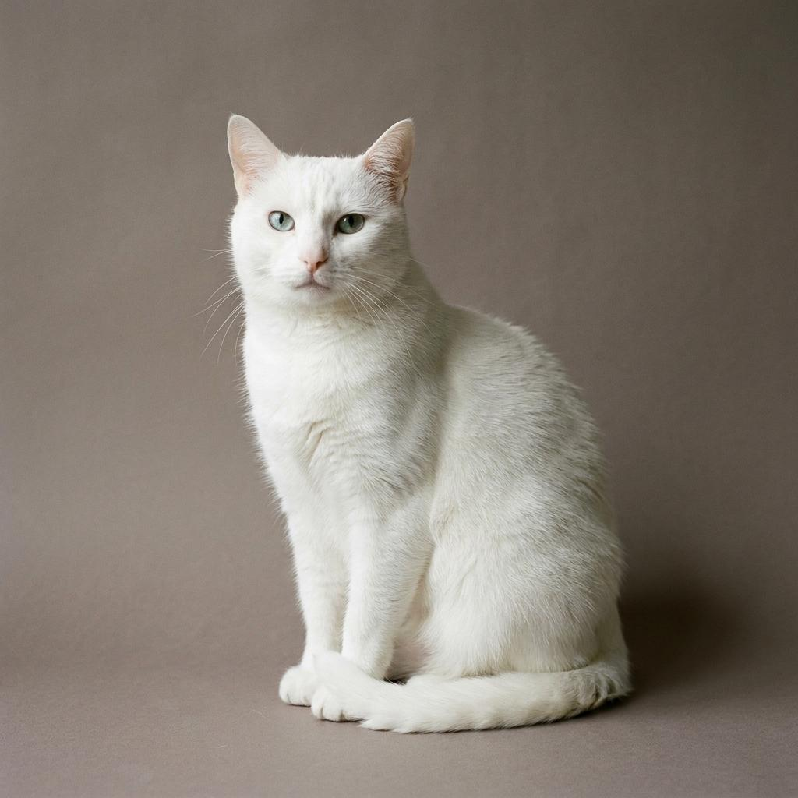
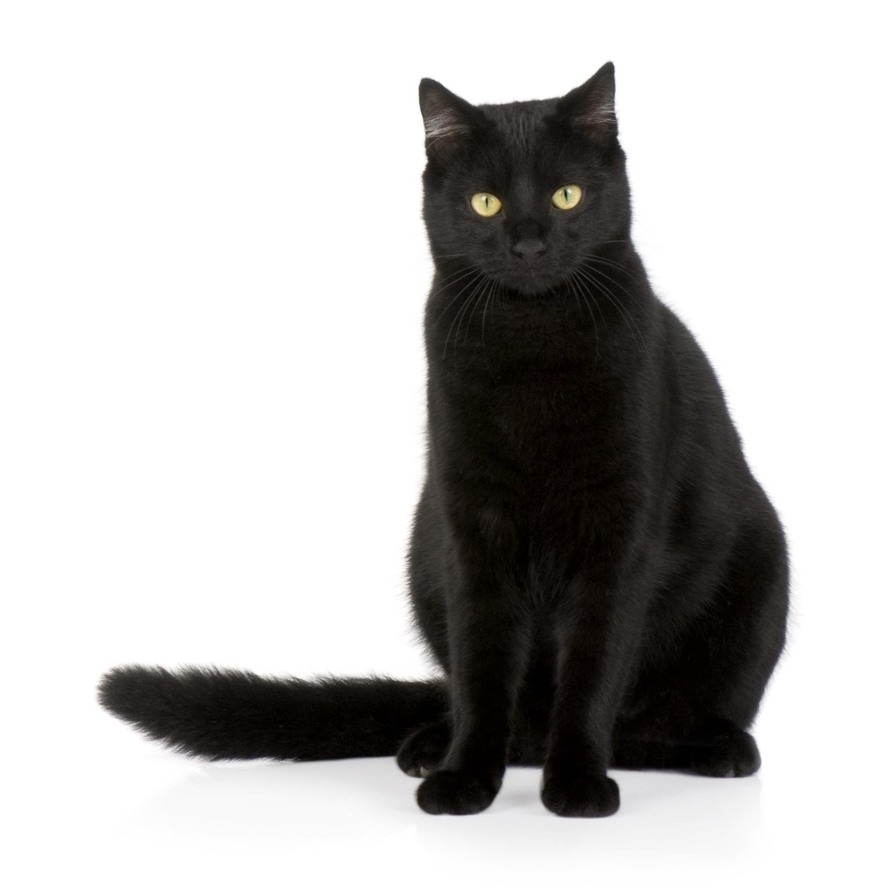
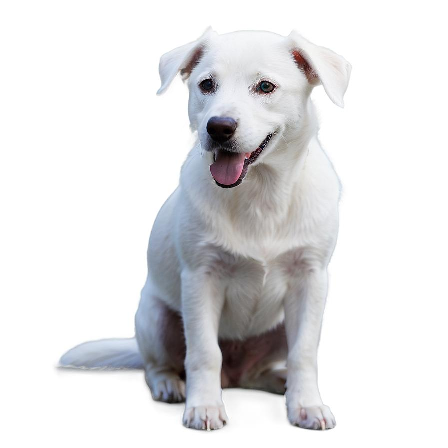

**大语言模型入门系列 · 学习者版 v0.1**

前一课：[怎样用数字表示信息？](./lesson-01-representation.md)

准备纸和笔。你只需要会比较数字、加法和乘法。不需要懂人工智能。请先试自己的办法，需要时再打开提示。

## 一、谁和白猫更像？

先看看上一课的三张照片：白猫、黑猫、白狗。

<div class="course-exercise">
<div class="course-photo-gallery">
<figure>
  
  <figcaption>白猫</figcaption>
</figure>
<figure>
  
  <figcaption>黑猫</figcaption>
</figure>
<figure>
  
  <figcaption>白狗</figcaption>
</figure>
</div>
</div>

再想象还有一张黑狗的照片。接下来的打分练习会用到这四种动物。

你觉得黑猫和白狗，哪一个更像白猫？为什么？

先写下你的理由。如果你觉得两者一样像，也可以。

<details>
<summary>想好以后，再看看几种回答</summary>

有人选黑猫，因为它也是猫。有人选白狗，因为它也是白色的。

还有人觉得它们一样像：各有一处相同。

我们比较的是不同的事情，所以答案可以不同。

</details>

现在我们约定一个小游戏：**颜色相同得一分，动物种类相同也得一分。** 两项都相同就得两分，两项都不同就得零分。

先不看数字卡片。你能给黑猫、白狗和黑狗分别打分吗？把答案记在纸上，稍后用来检查自己的计算方法。

## 二、让数字帮我们打分

上一课，我们做过这样的数字卡片：左格的 0 和 1 分别表示白色和黑色，右格的 0 和 1 分别表示猫和狗。

| 照片 | 左格 | 右格 |
|---|:---:|:---:|
| 白猫 | 0 | 0 |
| 黑猫 | 1 | 0 |
| 白狗 | 0 | 1 |
| 黑狗 | 1 | 1 |

现在请你设计一个办法。只看两张卡片上的数字，就能按照刚才的游戏规则打分。

如果你上一课设计了别的卡片，也可以先用自己的卡片来做。试试你设计的方法能不能处理这四种动物。

<details>
<summary>需要一点提示</summary>

白猫和白狗的第一格相同。第二格呢？每遇到一格相同，可以做什么？

</details>

<details>
<summary>完成以后，查看一种办法</summary>

一格一格比较。相同记 1 分，不同记 0 分，最后把分数加起来。

| 与白猫比较 | 颜色得分 | 种类得分 | 总分 |
|---|:---:|:---:|:---:|
| 白猫 | 1 | 1 | 2 |
| 黑猫 | 0 | 1 | 1 |
| 白狗 | 1 | 0 | 1 |
| 黑狗 | 0 | 0 | 0 |

对照你在第一节写下的答案。如果相同，说明这套办法完成了我们的打分任务。你自己的办法只要也能做到这一点，就同样有效。

</details>

## 三、还有别的计算方法吗？

刚才的方法已经够用了。现在我们来研究另一种办法，看看能不能让每一种共同的特征都直接贡献一分。

我们换一张卡片。它不再只有两个格子，而是给白色、黑色、猫、狗各留一个格子。有这个特征就写 1，没有就写 0。

| 照片 | 白色 | 黑色 | 猫 | 狗 |
|---|:---:|:---:|:---:|:---:|
| 白猫 | 1 | 0 | 1 | 0 |
| 黑猫 | 0 | 1 | 1 | 0 |
| 白狗 | 1 | 0 | 0 | 1 |
| 黑狗 | 0 | 1 | 0 | 1 |

想一想：我们怎样只用乘法和加法，把两张卡片共同拥有的特征数出来？

<details>
<summary>需要一点提示</summary>

试试计算 1×1、1×0、0×1 和 0×0。哪一种会得到 1？

</details>

<details>
<summary>看一种计算方法</summary>

两个格子都是 1 时，相乘才得到 1。因此我们可以把两张卡片同一位置的数字相乘，再把结果加起来。

例如白猫和黑猫：

```text
白猫      1    0    1    0
黑猫      0    1    1    0
逐格相乘  0    0    1    0
```

总分是 0 + 0 + 1 + 0 = 1。它们共同拥有的特征是“猫”。

</details>

现在不用看答案，算一算白猫与白狗、白猫与黑狗。结果和第一节一样吗？再任选两张卡片，预测它们的得分，然后计算检查。

这里我们做了同一件事：用不同的数字表示和计算方法，完成同一个打分任务。原来的办法也没有错。

## 四、现在由你决定比较什么

刚才的游戏把颜色和种类看得同样重要。现在，你可以自己决定比较什么。

试着写下：

- 我想比较什么？
- 我希望哪两张卡片得分更高？为什么？
- 原来的卡片和计算办法够用吗？我怎样检查？

如果你觉得够用，就保留。如果不够用，可以试着修改卡片或打分办法。

<details>
<summary>完成自己的尝试后，再看一个例子</summary>

假如我只想比较颜色，就不应该因为两只动物都是猫而多给一分。

我可以规定只比较颜色格子，再试白猫与黑猫、白猫与白狗，检查结果是否符合新规则。

</details>

<section class="course-exercise course-score-lab" data-course-score data-course-control hidden>
<strong>换一个比较标准，看看得分</strong>
<p>以白猫为参照。先预测哪个得分最高，再选一个标准。每项符合得一分，图中的刻度统一为 0 到 2 分。</p>
<fieldset class="course-score-options">
<legend>选择比较标准</legend>
<label><input type="radio" name="comparison-standard" value="colour">只比颜色</label>
<label><input type="radio" name="comparison-standard" value="type">只比种类</label>
<label><input type="radio" name="comparison-standard" value="both">两项都比</label>
</fieldset>
<ul class="course-score-results" data-score-results hidden aria-live="polite">
<li data-colour-match="0" data-type-match="1"><span>黑猫</span><meter min="0" max="2" value="0" aria-label="黑猫 得分"></meter><strong data-score-value>0</strong></li>
<li data-colour-match="1" data-type-match="0"><span>白狗</span><meter min="0" max="2" value="0" aria-label="白狗 得分"></meter><strong data-score-value>0</strong></li>
<li data-colour-match="0" data-type-match="0"><span>黑狗</span><meter min="0" max="2" value="0" aria-label="黑狗 得分"></meter><strong data-score-value>0</strong></li>
</ul>
</section>

## 五、回头看看：我们学到了什么？

上一课，我们学会了用数字表示事物。这一课，我们开始利用这些数字计算事物之间的关系。

首先要知道自己想比较什么。然后才决定怎样写数字、怎样计算。最后用已经知道的答案检查计算结果。

在第三节中，我们把两组数字同一位置的数相乘，再相加。这种运算在数学上叫作**点积（Dot Product）**。

在我们的四格卡片中，点积刚好等于两只动物共同拥有的特征数。但换一种数字卡片，或者换一个比较目标，就不一定成立了。

## 六、认识真实的大语言模型

在 Transformer 中，模型也会将一组数字与另一组数字进行点积，得到一个分数。这是它计算不同位置的信息如何匹配的一种重要操作。

不过，真实模型的数字不是我们手工写出的动物特征。它也不是在数两个词有哪些共同的特征。点积是同样的数学运算，分数的含义则取决于模型使用的表示和学到的计算规则。

| 正式术语 | 本课的含义 |
|---|---|
| 关系（Relation） | 两个对象之间可以描述或检验的联系；本课研究的是共同特征。 |
| 相似度（Similarity） | 按选定标准衡量相似程度；不只有一种标准。 |
| 点积（Dot Product） | 对两组等长数字逐项相乘，再求和。 |
| 匹配分数（Compatibility Score） | 衡量两份表示是否匹配的数值；Transformer 使用点积作为计算这种分数的基础。 |

真实 Transformer 还会对这些分数作进一步处理。今天先不用研究那些步骤。

## 七、带着自己的问题进入下一课

现在，我们已经能用数字表示信息，也能用计算得到某种匹配分数。

你还想用这些卡片做什么？请写下一个新问题，以及你准备怎样检查自己的想法。

下一课将探索一个问题：同一个对象，在不同任务中，能不能使用不同用途的数字表示？
